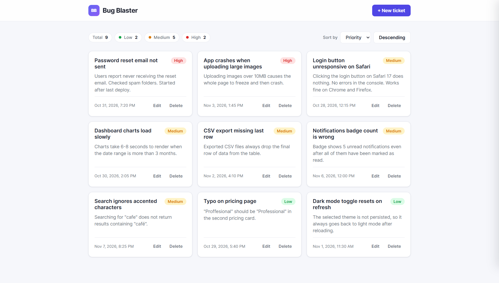
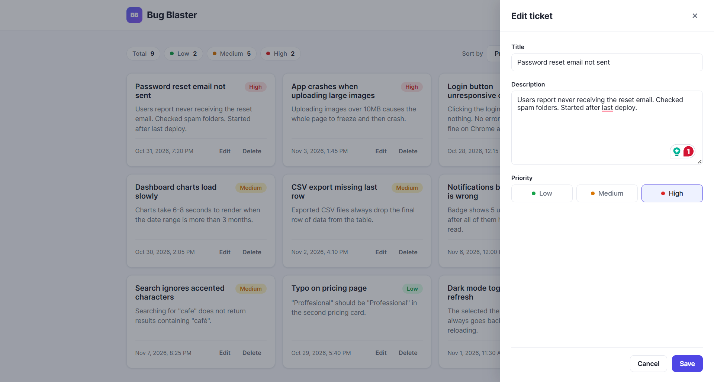

# Bug Blaster

This project is project 2 of 5 projects for the React course on Udemy [React 18 / 19 Course 2025](https://www.udemy.com/course/master-react)

## Project description

- A frontend web app using React, in which a user can create, edit, delete and sort bug tickets. The project is a practice of managing app state with a reducer (`useReducer`) and dispatched actions.

[Deployment link](https://darling-stroopwafel-f25709.netlify.app)




## Author

- Hiba Salem

## Features

- Create, edit and delete tickets with a priority level
- Ticket counts per priority
- Sort by date or priority
- Tickets saved in local storage

## Resources and Technologies

- Built with React (`useReducer` for ticket state with `ADD_TICKET`, `UPDATE_TICKET`, `DELETE_TICKET` and editing actions, hooks, reusable components and component composition)

## Getting started

```bash
npm install
npm start
```

Then open [http://localhost:3000](http://localhost:3000).
